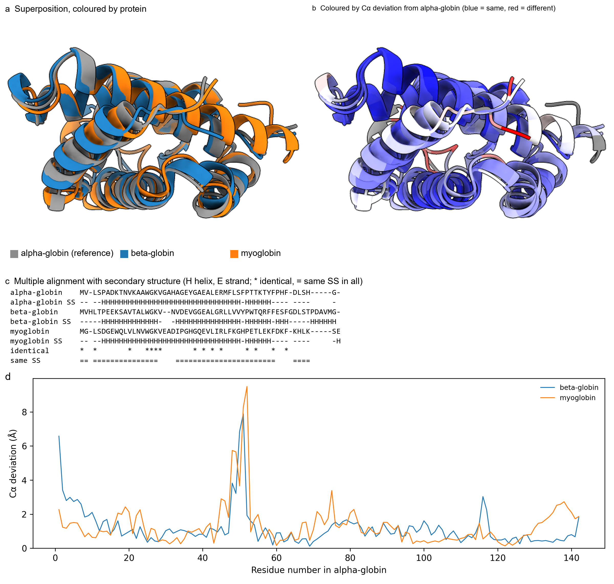

# ChimeraX-CompareStructures

A small [UCSF ChimeraX](https://www.cgl.ucsf.edu/chimerax/) bundle that adds one
command, `compare`. Give it two or more protein structures and it superposes
them, then tells you how they differ in both secondary (2D) and tertiary (3D)
structure, all in one go.

I wrote it because I kept running `matchmaker` pair by pair, copying RMSDs into
a spreadsheet and squinting at sequence alignments to work out whether a helix
was conserved. `compare` does all of that at once and gives you tables you can
put straight into a paper.

*Human alpha-globin, beta-globin and myoglobin (AlphaFold models). (a) The three
structures superposed. (b) Coloured by how far each residue sits from
alpha-globin. (c) Part of the multiple alignment, with each protein's secondary
structure underneath. (d) Per-residue deviation along the reference. Made with
`docs/make_figure.py`.*

## What you get

- **A summary table**: length, % helix / strand / coil, % sequence identity,
  pruned and all-pairs Cα RMSD, TM-score and % secondary-structure agreement
  for each structure against the reference.
- **All-against-all matrices** of RMSD, identity and secondary-structure
  agreement, so you can compare every pair, not just each one to the reference.
- **Per-residue deviation**, coloured onto the cartoons (blue = same, red =
  different) and stored in the residue attribute `compare_dev`, so you can
  select or colour by it yourself.
- **A multiple alignment** built from the superposition, with each protein's
  secondary structure underneath and markers for positions that are identical
  or have the same secondary structure in every protein.
- **Substitutions** between each structure and the reference, with the local
  deviation at each site. Handy for a mutant against its wild type.
- With `report <folder>`: all of the above as TSV files, the alignments as text
  and FASTA, a per-position conservation table and a deviation plot.

## Install

From a release: download the `.whl` file from the
[Releases page](https://github.com/LeonidasSp/chimerax-compare/releases) and run
this in ChimeraX:

    toolshed install /path/to/chimerax_comparestructures-0.1-py3-none-any.whl

From source: clone the repository and run

    devel install /path/to/chimerax-compare

It needs ChimeraX 1.4 or newer and was developed on 1.12.

## Use

    compare #1,2,3                       # the first model is the reference
    compare #2,3 to #1 report results    # pick the reference, write files
    compare #2 to #1 substitutions true  # mutant against wild type

Options: `to` (reference structure), `dssp` (recompute secondary structure,
default true), `color` (default true), `maxDeviation` (red end of the colour
scale in Å, default 5), `substitutions` and `report`.

To reproduce the figure above:

    alphafold fetch P69905
    alphafold fetch P68871
    alphafold fetch P02144
    compare #1,2,3 report globins

## Comparing a mutant with the wild type

ChimeraX's `swapaa` only swaps the side chain and leaves the backbone where it
was, so a `swapaa` mutant always looks identical to the wild type here. To see
whether a mutation changes the structure, predict the mutant sequence
separately (AlphaFold Server, ColabFold or ESMFold), open both models and run
`compare`.

## Things to keep in mind

- The TM-score is calculated on the matchmaker superposition, normalised by
  the reference length. It is not re-optimised the way TM-align does it, so
  treat it as a lower bound.
- Predicted models often have long disordered tails, which inflate the
  all-pairs RMSD. The pruned RMSD and the per-residue plot are more useful for
  the folded core.
- In the multiple alignment, every protein is aligned to the reference. Extra
  residues that two non-reference proteins both have at the same spot are put
  in the same columns but are not aligned to each other.

## Tests

    python tests/test_core.py

## Citing

If you use it in a paper, please cite this repository (GitHub's "Cite this
repository" button uses `CITATION.cff`) and ChimeraX itself:

> Meng EC, Goddard TD, Pettersen EF, Couch GS, Pearson ZJ, Morris JH,
> Ferrin TE. UCSF ChimeraX: Tools for structure building and analysis.
> *Protein Science* 2023; 32(11): e4792.

## Licence

MIT. See `LICENSE`.

Questions, bugs and ideas are welcome as
[issues](https://github.com/LeonidasSp/chimerax-compare/issues).
